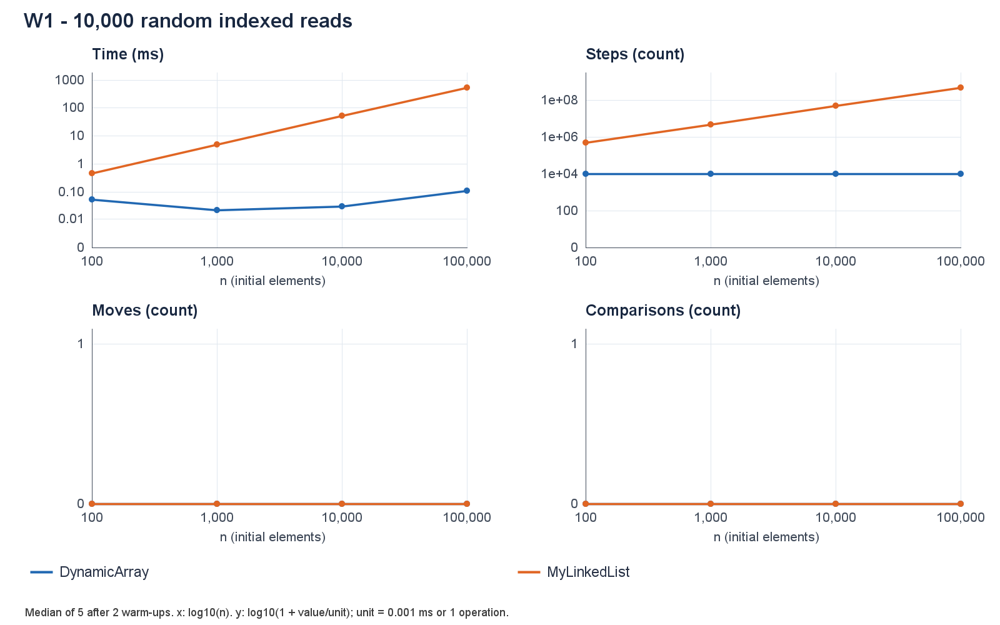
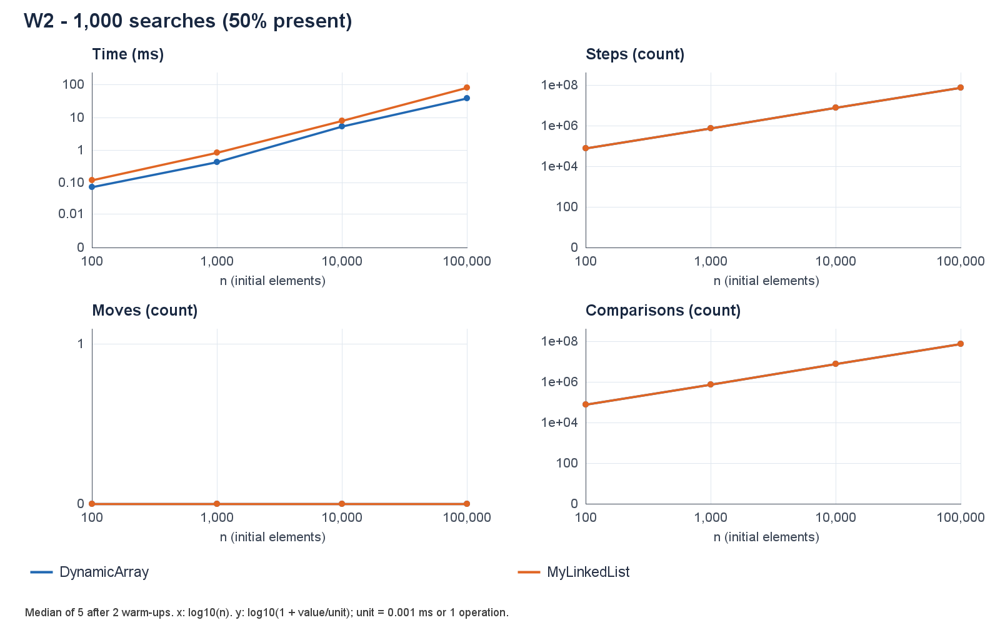
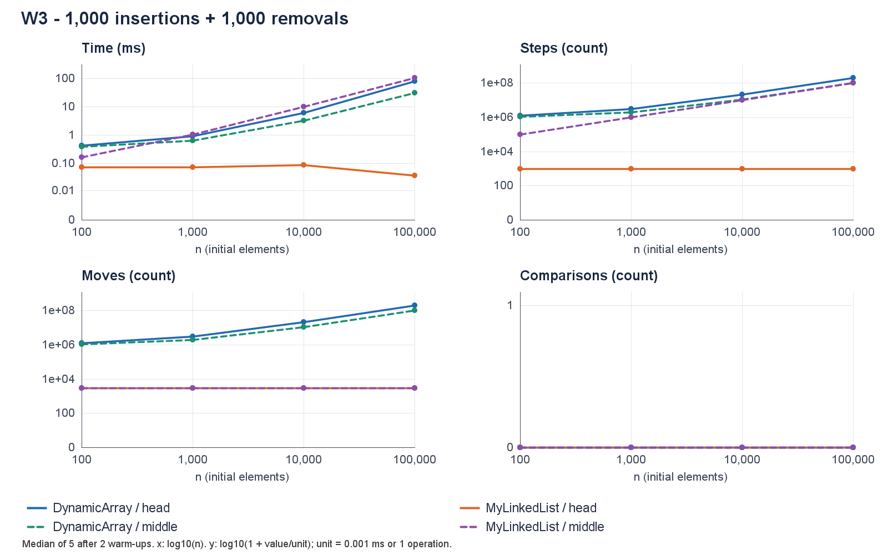
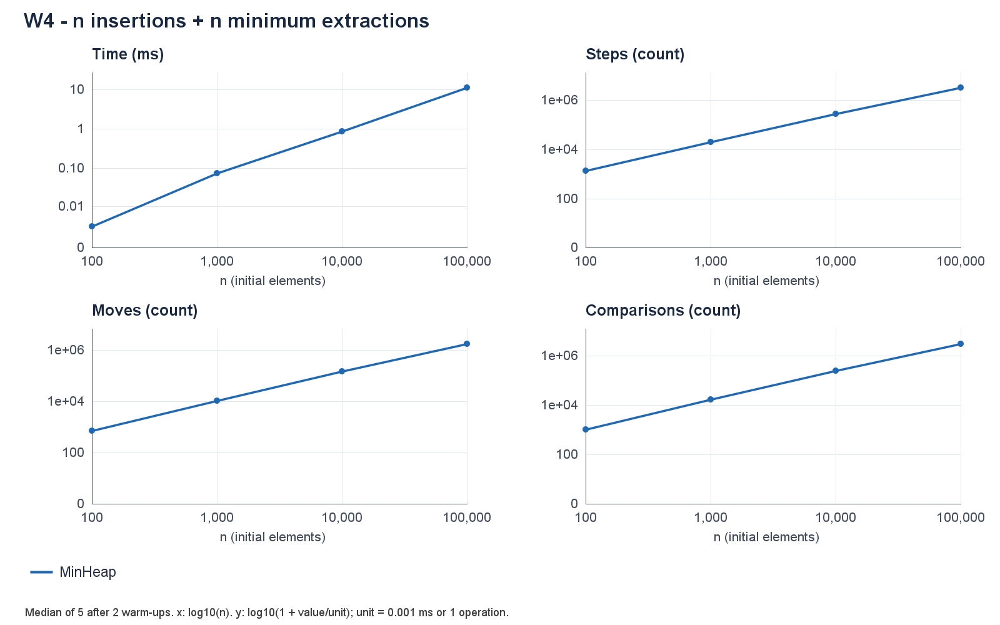
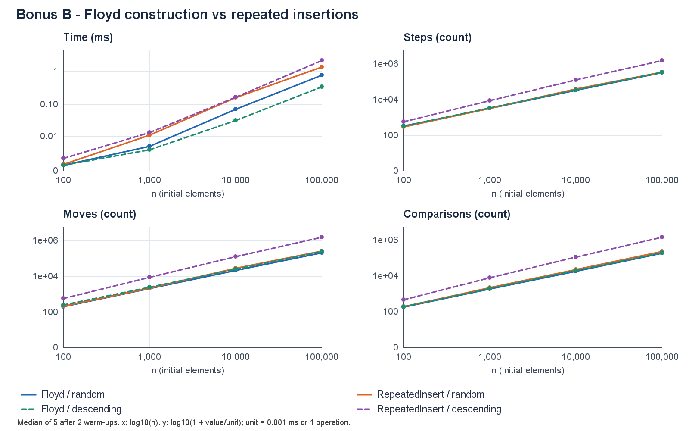

# Assignment 2 - In-Memory Workload Engine

**Yerbol Alikhan | SE-2517 | 04 October 2026**

Repository: [github.com/alikhanov0/assignment2](https://github.com/alikhanov0/assignment2) - branch `main`, tag `v1.0`.

## 1. Design and asymptotic analysis

DynamicArray owns an `int[]`, doubles full storage and shifts elements for indexed changes. MyLinkedList is singly linked with head and tail pointers. MinHeap owns an `int[]`, doubles capacity, and restores order by moving values along a single path. All three store primitive ints. Array/list share `IntSequence`; counters are incremented inside operations. No structure uses Java collections.

Let n be the current size. Bounds below are for valid operations on nonempty structures; an empty search is Θ(1). Sequence averages assume a uniformly chosen valid index or a uniformly located hit / constant miss probability. Heap averages assume random distinct priorities; amortized bounds account for doubling over an operation sequence. Space denotes additional storage allocated by an operation, not already owned capacity.

| Structure / operation | Best | Average | Worst | Extra space | Justification |
|---|---|---|---|---|---|
| Array add(x) | Θ(1) | Θ(1) amort. | Θ(n) | Θ(1); Θ(n) growth | Append; full capacity requires a copy. |
| Array add(i,x) | Θ(1) | Θ(n) | Θ(n) | Θ(1); Θ(n) growth | Shift n-i values, possibly copy storage. |
| Array remove(i) | Θ(1) | Θ(n) | Θ(n) | Θ(1) | Shift n-i-1 values; never shrink. |
| Array get(i) | Θ(1) | Θ(1) | Θ(1) | Θ(1) | Compute address; one array read. |
| Array contains(x) | Θ(1) | Θ(n) | Θ(n) | Θ(1) | Stop at first match or scan all values. |
| List add(x) | Θ(1) | Θ(1) | Θ(1) | Θ(1) | Tail pointer avoids traversal. |
| List add(i,x) | Θ(1) | Θ(n) | Θ(n) | Θ(1) | Head/tail fast paths; otherwise find predecessor. |
| List remove(i) | Θ(1) | Θ(n) | Θ(n) | Θ(1) | Head fast path; otherwise find predecessor. |
| List get(i) | Θ(1) | Θ(n) | Θ(n) | Θ(1) | Follow i links from head. |
| List contains(x) | Θ(1) | Θ(n) | Θ(n) | Θ(1) | Inspect a prefix, possibly the entire list. |
| Heap insert(x) | Θ(1) | Θ(1) expected amort. | Θ(n) | Θ(1); Θ(n) growth | Bubble up; resizing can copy n values. |
| Heap peekMin() | Θ(1) | Θ(1) | Θ(1) | Θ(1) | Root is the minimum. |
| Heap extractMin() | Θ(1) | Θ(log n) | Θ(log n) | Θ(1) | Stop early or descend the tree height. |
| Heap buildHeap(a) | Θ(n) | Θ(n) | Θ(n) | Θ(n) owned copy | Copy input and sift internal nodes bottom-up. |

Every Θ bound supplies both a matching O upper bound and Ω lower bound. For heap insertion without growth, the worst case is Θ(log n); over any sequence the amortized upper bound is O(log n), tight for decreasing priorities. Under the stated random-priority model, expected bubble-up length is constant, so expected amortized insertion is Θ(1). A single call at full capacity still costs Θ(n). For all-equal heaps, extractMin stops near the root; the average column assumes random distinct keys.

Doubling copies fewer than 2m existing values across m appends, proving amortized Θ(1) array append. Persistent storage is Θ(n) for every structure (Θ(n+1) including empty capacity); the list also pays for one object and reference per element. `size()`, `capacity()` and `metrics()` are Θ(1); the diagnostic `snapshot()` is Θ(n) time and extra space and is never timed as an operation. Invalid-index and empty-heap exceptions are checked in Θ(1).

## 2. Correctness proofs and measurement method

### Proof A - DynamicArray.remove(index)

**Invariant.** Let A be the original array prefix of length m and k the requested index. Before each iteration with loop variable i, `removed = A[k]`; positions j < k are unchanged; every k ≤ j < i contains A[j+1]; every i ≤ j < m still contains A[j]. The field `size` is still m, and k ≤ i ≤ m-1.

**Initialization.** The method validates k, saves A[k] and sets i=k. The shifted range is empty and the whole array is unchanged, so all parts hold.

**Maintenance.** If i < m-1, the source at i+1 is still A[i+1]. Assigning it to position i extends the shifted prefix by exactly one element without modifying the remaining suffix. Incrementing i restores the invariant for the next iteration.

**Termination.** The nonnegative quantity m-1-i decreases each iteration. At i=m-1 the loop stops; positions k through m-2 contain A[k+1] through A[m-1]. Decrementing size discards the unused final slot, and the stored removed value is returned.

**Conclusion.** The visible sequence is precisely A with its k-th element deleted, preserving the order and value of every remaining element. The proof also covers removal of the last or only element because the shifted range is empty.

### Proof B - MyLinkedList.contains(value)

**Invariant.** Before each while-loop test, `current` points to the first unexamined node, or is null if all nodes were examined. Every node before `current` has a value different from the search key; the list's links, size and values are unchanged.

**Initialization.** `current=head`, so the examined prefix is empty. This is also true when the list is empty and head is null.

**Maintenance.** If the current value equals the key, returning true is correct. Otherwise the current node can be added to the examined prefix and `current=next(current)` selects the next unexamined node, preserving the invariant.

**Termination.** Each unsuccessful iteration decreases the number of unexamined nodes by one. A successful comparison proves existence; reaching null proves every node differs from the key, so returning false proves absence.

**Conclusion.** The method returns true exactly when a stored value equals the key, including duplicate-value and empty-list cases, without modifying the list.

### Counters and experiment

One step is one array-cell read or one traversal of a list's next link, including a traversal to null. One move is one relocation of an existing array element (including growth copies) or one explicit structural pointer update, including head and tail. New int writes, local cursor assignments and default-null initialization are excluded. One comparison compares two element values; loop/index/null checks are excluded. Thus list get(0) uses zero traversal steps, and head changes still have nonzero moves. These event types have different costs and do not measure every CPU instruction.

For each n in {100, 1,000, 10,000, 100,000}, identical nonnegative data comes from `new Random(42)`. Search queries alternate sampled present values with negative absent values. The JVM performs 60 discarded priming rounds at n=1,000, then two discarded warm-ups and five measured runs per case. CSV records median time and that run's counters; all 364 per-case observations, including bonus cases, remain in `runs.csv`. W1-W3 exclude filling; W4 includes all inserts/extractions. Generation, validation and plotting are outside the timer. The fixed-order, instrumented experiment uses System.nanoTime, JDK 19.0.2, Windows 11 and AMD Ryzen 5 4600H; it is not a hardware-counter experiment or a multi-fork JMH study.

## 3. Random access and search

W1 performs exactly 10,000 get calls regardless of n. The array always records 10,000 steps. At n=100,000 the list follows 502,489,208 links: about n/2 per read. Median times are 0.1072 ms and 536.9342 ms respectively. Small sub-millisecond times need not be monotonic because clock granularity, caching and JIT effects remain.

W2 performs 1,000 searches with exactly 500 hits. At n=100,000 both structures make 74,929,350 element comparisons; list traversal steps are 500 fewer because successful hits do not advance past the matching node. Array time is 38.3540 ms versus 83.0850 ms for the list. Equal or zero series overlap in the charts. Every chart uses logarithmic n and log(1+value/unit) vertically, so zero remains visible.

## 4. Boundary changes and priority processing

W3 inserts 1,000 values, then removes 1,000 at the same fixed index (0 or original n/2). At n=100,000 the array makes 200,999,000 head shifts versus 100,999,000 middle shifts; no growth is needed at this size. List moves are 3,000 in both variants, but traversal steps are 1,000 at the head and 100,000,000 in the middle. Median head times are 80.9175 ms (array) / 0.0359 ms (list), versus 30.5168 / 106.2589 ms in the middle.

W4 inserts n values and extracts n minima, checking non-decreasing output and a checksum outside the timer. For n=100,000, the total is 11.1729 ms, 3,390,180 steps, 1,759,235 moves and 3,059,125 comparisons. Comparisons/(n log2 n) rise from about 1.56 to 1.84 across the four sizes, consistent with Θ(n log n) total processing. Validation tests additionally compare exact output against a standard priority queue and check every parent-child relation after every mutation.

## 5. Bonus B and discussion

**Linear construction.** Floyd processes internal nodes backwards, so each node's children already root valid heaps when it is sifted down. There are O(n/2^h) nodes of height h, giving total work bounded by a constant times n times the convergent sum of h/2^h; copying the input also takes Θ(n). On descending n=100,000 input, Floyd uses 199,978 comparisons and 0.3371 ms, versus 1,468,946 and 2.1439 ms for insertion. On random input, the counts are 188,424 and 227,662: repeated insertion also has expected linear total work here, so random data alone would not demonstrate its worst-case Θ(n log n) cost. Both construction methods own their storage; extraction is excluded from this bonus timing.

**Discussion (12 sentences).** DynamicArray computes an indexed address directly, whereas MyLinkedList follows a chain of dependent pointers. Consecutive array ints occupy nearby cache lines, allowing spatial locality and hardware prefetching to benefit a scan. W2 therefore shows an array advantage despite identical comparison counts. A list can be slower with nearly equal step counts because its next address depends on a previous load, which limits parallel memory access. Each list node also needs an object header, an int, a reference and alignment padding, reducing useful values per cache line. Separate node allocations add garbage-collector work and can place nodes farther apart, although this experiment does not measure exact object sizes or cache misses. Filling is excluded from W1-W3 timing, but the resulting layout and later garbage collection can still affect measured performance. MyLinkedList is a better fit for repeated head changes, because those operations update a constant number of links. A singly linked list's tail pointer makes append constant time, but removing the tail still requires finding its predecessor. Middle changes can favor the array even when it shifts many values, because contiguous movement is cheaper per element than chasing pointers. MinHeap is a better fit for scheduling when only the current minimum is needed, offering constant-time inspection and logarithmic worst-case removal. Timings here include counter overhead and use one JVM with fixed case order, so operation-count trends are stronger evidence of growth rates than any single runtime ratio.

**Validation and delivery.** All 20 JUnit 5 tests pass, covering mixed random operations, boundaries, duplicates, integer extremes, invalid inputs, exact counters, heap properties and Floyd input isolation. The release includes 36 required CSV rows, 16 bonus rows, five PNG figures, reproducible commands, feature branches and tag v1.0. Memory-footprint bonus A is outside this submission; no measured-memory claim is made.
